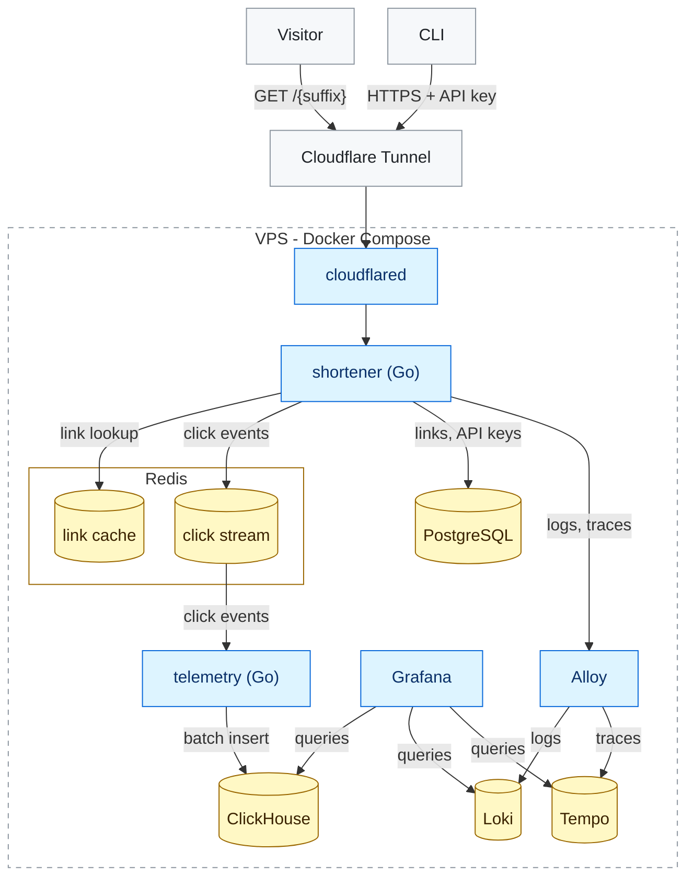

# just-short-it

This project is a highly efficient link shortener designed with focus on telemetry and data gathering, so you can get a real insight into it's performance and usage data.

# Architecture

There is no frontend. Links are managed from a CLI client over an HTTP API or direct API calls with token for authorization.
Visitors only ever see a redirect. Everything runs on a single VPS with Docker Compose behind Cloudflare.

## Components

| Component         | Role                                                                                                |
| ----------------- | --------------------------------------------------------------------------------------------------- |
| Cloudflare Tunnel | TLS, DDoS protection, client IP and geolocation headers                                             |
| `cloudflared`     | Tunnel from Cloudflare to the VPS, so no inbound ports are open                                     |
| `shortener`       | Go service with public redirects and the link management API on separate listeners and hostnames    |
| `telemetry`       | Go worker that reads click events from Redis, enriches them, and batch-inserts them into ClickHouse |
| `cli`             | Go CLI to create, list, edit, and disable links, and to generate QR codes locally                   |
| PostgreSQL        | Links and API keys, the source of truth                                                             |
| Redis             | Link cache, click counters, and the click event stream that buffers telemetry                       |
| ClickHouse        | Click events for analytics                                                                          |
| Grafana           | Dashboards on top of ClickHouse, Loki, and Tempo                                                    |
| Loki              | Container logs of the services                                                                      |
| Tempo             | OpenTelemetry traces of the services                                                                |
| Alloy             | Collects container logs and OTLP traces and forwards them to Loki and Tempo                         |
| dbmate            | Migrations for PostgreSQL and ClickHouse                                                            |

## Redirect path

1. `shortener` looks the suffix up in Redis and falls back to PostgreSQL, filling the cache. Unknown suffixes are cached briefly as well.
2. It answers `307` with `Cache-Control: no-store`, so every click reaches the server. Unknown suffixes get `404`, expired or disabled links get `410`.
3. The click event goes to an in-memory queue and from there to a Redis Stream. The visitor never waits for telemetry.
4. `telemetry` consumes the stream and writes to ClickHouse. If ClickHouse is down, events wait in Redis and redirects keep working.

## Link management

- Each person has their own API key. Only its SHA-256 hash is stored. The first key is created with a subcommand of the `shortener` binary.
- Suffixes are user-defined and normalized to lowercase.
- A link can have an expiry date and a click limit, and can be edited or disabled. Both invalidate its cache entry.

## Telemetry

Collection is passive, with no JavaScript and no interstitial page:

- Network: country, region, city, timezone, and ASN.
- Device: User-Agent parsed into device type, OS, and browser.
- Client Hints (`Accept-CH` with `Critical-CH`, Chromium only): device model, platform version, architecture, viewport width, DPR, memory, and connection type.
- Context: `Referer`, `Accept-Language`, `Sec-Fetch-*`, and HTTP method.
- Bots and link preview crawlers are flagged so they do not inflate the statistics.
- Operational: handling time and lookup source (Redis or PostgreSQL) in the same event.

Client IP addresses are never stored raw. `shortener` replaces them with an HMAC-SHA256 keyed by a secret from `.env` before the event leaves the process.

Logs and traces are retained for `28 days`.

# Deployment

Copy `.env.example` to `.env`, fill it in, and run one of:

| Command       | Role                                                                   |
| ------------- | ---------------------------------------------------------------------- |
| `make dev`    | Checks the prerequisites and starts the stack on loopback ports        |
| `make prod`   | Same as `make dev`, plus the `cloudflared` tunnel                      |
| `make down`   | Stops the stack, `VOLUME=1` also removes its volumes                   |
| `make status` | Checks that the containers run and that `shortener` and Grafana answer |
| `make update` | Pulls the latest commit and deploys it                                 |

`make status` and `make update` leave the tunnel out unless run with `TUNNEL=1`.
